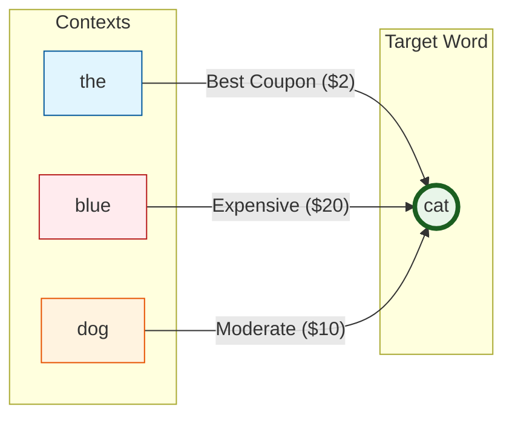
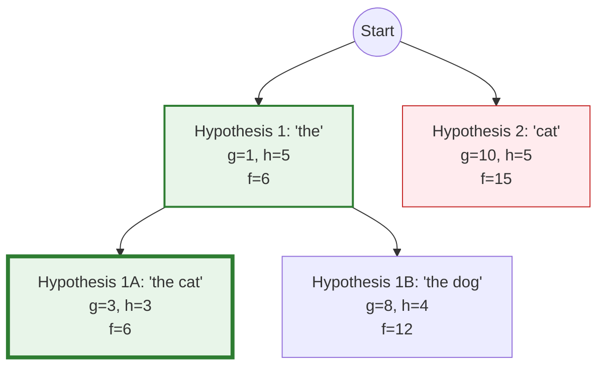
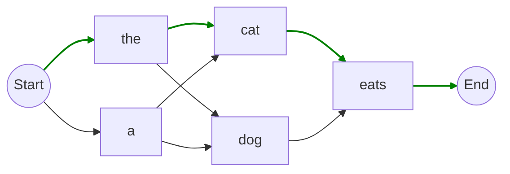
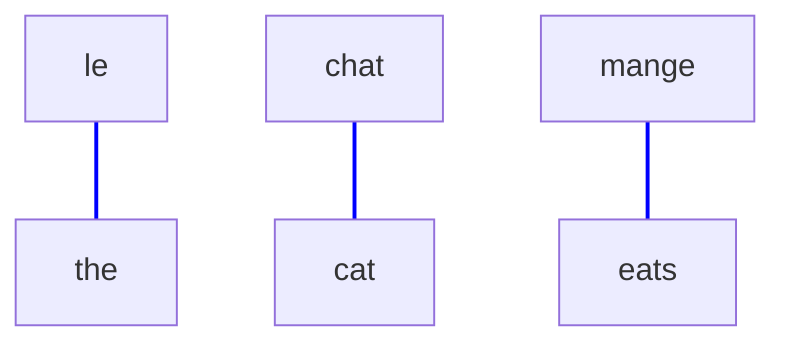
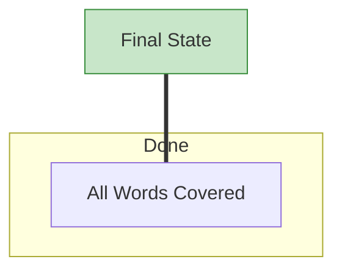
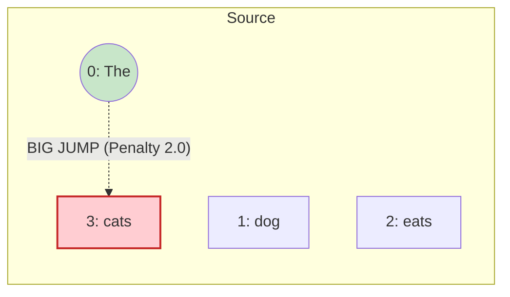
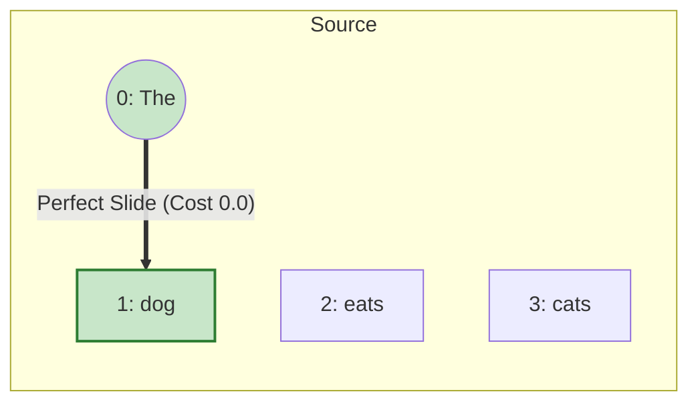

# SMT Decoder Visualizations

This document visualizes the core concepts of the SMT Decoder, including the A* search process, the Bigram Language Model, and the Decoding Lattice.

## 1. The "Best Coupon" Heuristic (Bigram Costs)
This graph illustrates the "Best Coupon" strategy mentioned in the explanation. The heuristic optimistic guess assumes we can always use the cheapest transition (the "best coupon") for any word, regardless of context.



## 2. A* Search Tree Expansion
This tree shows how the A* algorithm explores the search space. It prioritizes the path with the lowest estimated total cost ($f(n) = g(n) + h(n)$).

*   **g($n$)**: Cost so far (path taken).
*   **h($n$)**: Heuristic guess (estimated remaining cost).



> **Note**: The search follows the green nodes (lowest $f$ score) first!

## 3. Decoding Lattice (Word Graph)
This represents the possible paths the decoder can take through the output words. The goal is to find the lowest-cost path from Start to End covering all source words.



## 4. Source-Target Alignment Matrix
A simple visualization of which source words map to which target words.

| Source (French) | Target (English) | Prob $P(f|e)$ |
| :--- | :--- | :--- |
| **le** | the | 0.8 |
| **chat** | cat | 0.9 |
| **mange** | eats | 0.7 |



## 5. Step-by-Step Heuristic Calculation (Longer Example)
Let's trace the heuristic $h(n)$ for a longer sentence:
**Source**: "le petit chat noir" (the little black cat)

**Pre-calculation (The "Cheat Sheet")**:
We find the absolute minimum transition cost for every source word *before* decoding starts.
*   **le**: Min cost = **$1.0$**
*   **petit**: Min cost = **$2.0$**
*   **chat**: Min cost = **$1.5$**
*   **noir**: Min cost = **$2.5$**

---

### A. Start State (Nothing Translated)
*   **Covered**: {}
*   **Remaining**: {le, petit, chat, noir}
*   **Heuristic**: Sum of *all* remaining costs.

$$h(\text{start}) = 1.0 + 2.0 + 1.5 + 2.5 = \mathbf{7.0}$$

```mermaid
graph TD
    Start((Start State))
    
    subgraph Future Costs (Total: 7.0)
    L["le ($1.0)"]
    P["petit ($2.0)"]
    C["chat ($1.5)"]
    N["noir ($2.5)"]
    end
    
    Start -.-> L
    Start -.-> P
    Start -.-> C
    Start -.-> N
    
    style Start fill:#fff9c4,stroke:#fbc02d
```

---

### B. Step 1: Translated "le" -> "the"
*   **Covered**: {le}
*   **Remaining**: {petit, chat, noir}
*   **Heuristic**: sum({petit, chat, noir})

$$h(\text{step 1}) = 2.0 + 1.5 + 2.5 = \mathbf{6.0}$$

```mermaid
graph TD
    S1["hyp: 'the'"]
    
    subgraph Done
    L_Done[le]
    end
    
    subgraph Future Costs (Total: 6.0)
    P["petit ($2.0)"]
    C["chat ($1.5)"]
    N["noir ($2.5)"]
    end
    
    S1 === L_Done
    S1 -.-> P
    S1 -.-> C
    S1 -.-> N
    
    style S1 fill:#bbdefb,stroke:#1976d2
    style L_Done fill:#bdbdbd,stroke:#757575
```

---

### C. Step 2: Translated "le petit" -> "the little"
*   **Covered**: {le, petit}
*   **Remaining**: {chat, noir}
*   **Heuristic**: sum({chat, noir})

$$h(\text{step 2}) = 1.5 + 2.5 = \mathbf{4.0}$$

```mermaid
graph TD
    S2["hyp: 'the little'"]
    
    subgraph Done
    L_Done[le]
    P_Done[petit]
    end
    
    subgraph Future Costs (Total: 4.0)
    C["chat ($1.5)"]
    N["noir ($2.5)"]
    end
    
    S2 === L_Done
    S2 === P_Done
    S2 -.-> C
    S2 -.-> N
    
    style S2 fill:#bbdefb,stroke:#1976d2
    style L_Done fill:#bdbdbd,stroke:#757575
    style P_Done fill:#bdbdbd,stroke:#757575
```

---

### D. Step 3: Translated "le petit chat" -> "the little cat"
*   **Covered**: {le, petit, chat}
*   **Remaining**: {noir}
*   **Heuristic**: sum({noir})

$$h(\text{step 3}) = \mathbf{2.5}$$

```mermaid
graph TD
    S3["hyp: 'the little cat'"]
    
    subgraph Done
    L_Done[le]
    P_Done[petit]
    C_Done[chat]
    end
    
    subgraph Future Costs (Total: 2.5)
    N["noir ($2.5)"]
    end
    
    S3 === L_Done
    S3 === P_Done
    S3 === C_Done
    S3 -.-> N
    
    style S3 fill:#bbdefb,stroke:#1976d2
    style L_Done fill:#bdbdbd,stroke:#757575
    style P_Done fill:#bdbdbd,stroke:#757575
    style C_Done fill:#bdbdbd,stroke:#757575
```

---

### E. Final State: "the little cat black" (Wait, strictly keeping order for simplicity)
Assuming simple order for this visual explanation (or "black cat" if reordering allowed, but heuristic logic is same: removing covered word costs).
*   **Covered**: {le, petit, chat, noir}
*   **Remaining**: {}
*   **Heuristic**: 0

$$h(\text{final}) = \mathbf{0}$$



## 6. Where do these costs come from? (The Pre-calculation)
You correctly identified that the costs come from the **Minimum Bigram Transition**. We do this **before** the A* search starts.

**The Logic**:
1.  We have a target word (e.g., "le").
2.  We look at **all possible words** that could come before "le" in our Bigram list.
3.  We pick the **cheapest one**. This is our "Best Coupon".

### Data Analysis Example
**Your Bigram File (`bigrams.txt`)**:
```text
<s> le      0.69   <-- Cheapest way to get "le" is from Start
mange le    2.30   <-- Expensive way to get "le"
le chat     0.22   <-- Cheapest way to get "chat"
<s> chat    1.20   <-- Expensive way to get "chat"
```

**Resulting Heuristic Table**:
*   $h(\text{le}) = \mathbf{0.69}$
*   $h(\text{chat}) = \mathbf{0.22}$

---

---

## 7. The "Truth vs. Fluency" Standard (Distortion Enforcing Monotonicity)
You are absolutely right. The Distortion Model exists to **fight the Language Model** when the LM lies.

### The Conflict
*   **The Language Model (LM)**: Wants to output "fluent" French. It loves frequent pairs like "le chat" (the cat).
*   **The Distortion Model**: Wants to follow the **source text order**. It penalizes skipping words.

### The Example: "The dog eats cats"
**Source**: "The (0) dog (1) eats (2) cats (3)"
**Trap**: The bigram "le chat" is very common (Cost 0.2), while "le chien" might be rarer (Cost 0.5).

#### Path A: The Lie (Focusing only on Bigrams)
The decoder sees "The" -> "Le". Then it looks for the next word.
*   LM whispers: *"Pick 'chat'! 'Le chat' is a great bigram!"*
*   Decoder jumps to index 3 (cats).

**Calculation**:
1.  **Prev Index**: 0 ("The")
2.  **Next Index**: 3 ("cats")
3.  **Distortion Penalty**: $|3 - 0 - 1| = |2| \rightarrow$ **Cost 2.0**

**Total Cost** = $0.2 \text{ (Bigram)} + 2.0 \text{ (Distortion)} = \mathbf{2.2}$



#### Path B: The Truth (Respecting Monotonicity)
The decoder sees "The" -> "Le".
*   Distortion yells: *"Stick to the order! Go to index 1 (dog)!"*
*   Decoder picks "chien" (dog).

**Calculation**:
1.  **Prev Index**: 0 ("The")
2.  **Next Index**: 1 ("dog")
3.  **Distortion Penalty**: $|1 - 0 - 1| = |0| \rightarrow$ **Cost 0.0**

**Total Cost** = $0.5 \text{ (Bigram)} + 0.0 \text{ (Distortion)} = \mathbf{0.5}$



### The Result
Even though the LM liked "le chat" better (0.2 vs 0.5), the **Distortion Penalty (2.0)** made that path way too expensive ($2.2$ total).
The "True" path ("le chien") wins ($0.5$ total) because it respects the source structure.
